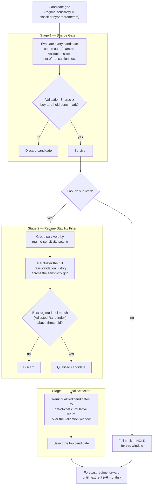
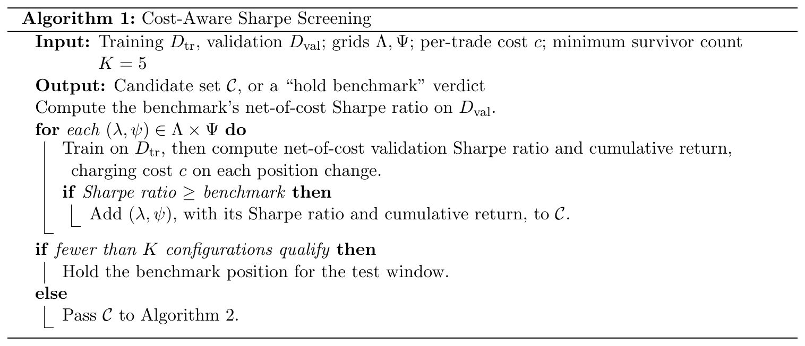
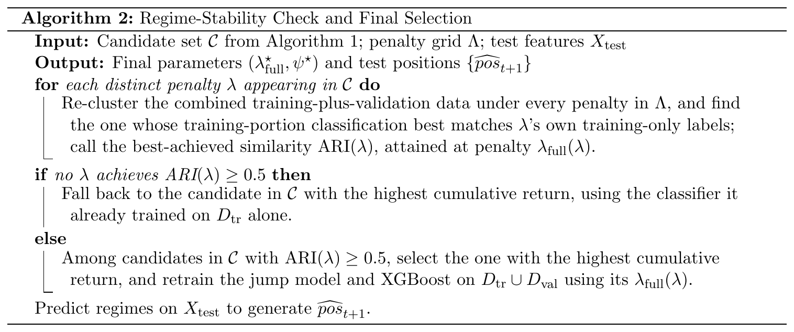

# Model-selection framework

This document describes how a regime-detection model is selected and refit at every step of the
walk-forward backtest. The training code is not published in this repository; the pseudocode is
given in the [Pseudocode](#pseudocode) section below.

## Setup

Each asset's history is split into a rolling sequence of windows:

- a **rolling estimation window** of 15 years ending at each refit date, made up of
  - an **11-year training block**, and
  - a **4-year validation block** (the most recent four years of the window);
- a **forecast window** running until the next refit, 6 months later.

The window is shifted forward by six months at every refit, so its length stays fixed at 15 years
(the first window covers 1992–2006).

At every refit, the model re-runs the full three-stage selection below on the current
train/validation split before forecasting forward.

## The three stages

### Stage 1 — Sharpe gate

Every candidate in the grid (a regime-sensitivity setting paired with a classifier
hyperparameter combination) is fit on the training window and scored on the validation window,
**net of the same transaction-cost assumption used in the final reported backtests** — the
selection process and the reported results share one cost model, so a candidate can't look good
during selection only because costs were ignored.

A candidate survives Stage 1 only if its net-of-cost validation Sharpe ratio beats the
buy-and-hold benchmark's Sharpe over the same window. If too few candidates clear this bar, the
model has no reliable signal for that window and explicitly falls back to **holding the
benchmark position** rather than forcing a forecast from a low-confidence model.

### Stage 2 — Regime stability filter

A regime classifier is only useful if the regimes it's built on are structurally stable, not an
artifact of one particular clustering setting. Surviving candidates are grouped by their
underlying regime-sensitivity setting, and each group is checked against a re-clustering of the
**full** training-plus-validation history across the whole sensitivity grid, using the Adjusted
Rand Index (ARI) to measure how well the two labelings agree.

Only candidates whose best-matching relabeling exceeds an ARI threshold pass — this discards
regime assignments that only "made sense" to one narrow slice of the data and wouldn't
generalize.

### Stage 3 — Final selection

Among the candidates that pass both gates, the model selects the single configuration with the
highest net-of-cost **cumulative return** over the validation window (rather than Sharpe, which
can be dominated by a low-volatility, low-return candidate). That configuration's classifier is
then used to forecast the regime forward, day by day, until the next scheduled refit.

## Pseudocode

The two selection steps, typeset as algorithms (the LaTeX source is in the paper's online supplement).
Within each rolling window, $\lambda$ is the jump penalty and $\psi$ the XGBoost hyperparameters.

The Adjusted Rand Index (ARI) used in Algorithm 2 is

$$
\text{ARI} = \frac{\text{RI} - \mathbb{E}[\text{RI}]}{\max(\text{RI}) - \mathbb{E}[\text{RI}]},
$$

where RI is the (unadjusted) Rand Index, the proportion of day-pairs on which two labelings agree.
ARI ranges from $-1$ to $1$: $1$ means identical labelings and $0$ means agreement no better than chance.

## Why this shape

- **Cost-aware at every stage** — the same trading-cost assumption used to report final
  performance is also used to gate candidates, so the selection process can't implicitly reward
  high-turnover configurations that only look good gross of cost.
- **Two independent survival criteria** (predictive out-of-sample performance, then regime
  stability) before a single final pick — reduces the chance of selecting a configuration that
  happens to perform well in-sample for a validation window but is not a structurally coherent
  regime split.
- **An explicit "do nothing" fallback** — when no candidate clears the bar, the model does not
  force a forecast; it holds the benchmark position for that window.
